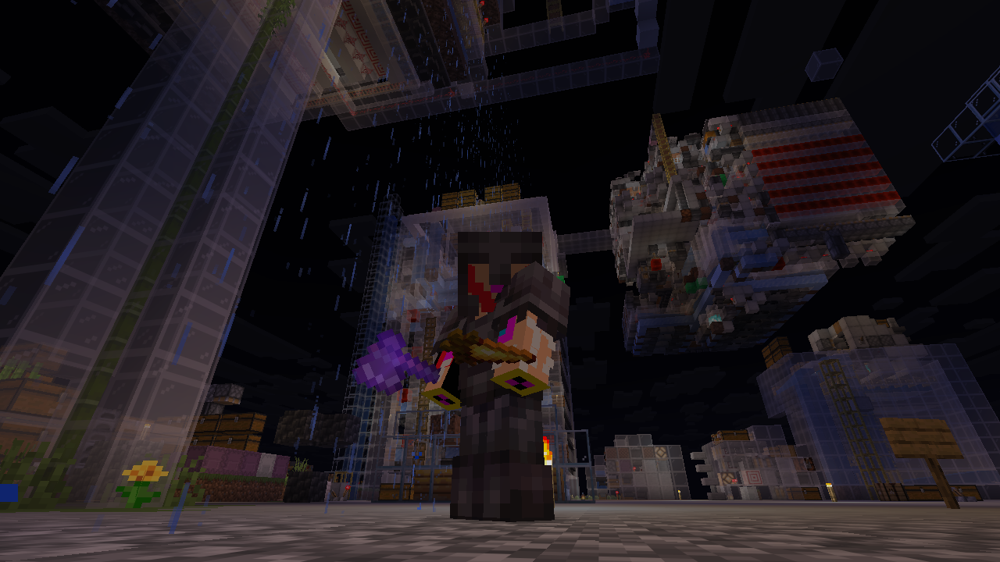
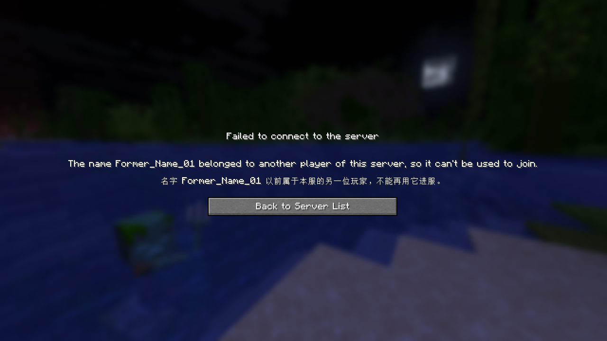

<p align="center"></p>
<h1 align="center">Offline Whitelist</h1>
<p align="center">Premium players on an offline-mode server: one UUID per account, real skins and capes, and a whitelist that works.</p>
<p align="center">让离线服像正版服一样对待正版玩家：每个账号一个固定的 UUID、显示正版皮肤和披风、白名单真正管用。</p>

<p align="center"><a href="#english">English</a> · <a href="#简体中文">简体中文</a></p>

   

# English

A server-side mod for servers that run with `online-mode=false`, for example because Mojang's login servers are often unreachable from where the server is. It treats the players who own a Minecraft account the way an online-mode server would, without ever needing Mojang to let anyone in.

On an offline-mode server, every player's UUID is calculated from their name. That's why renaming a Minecraft account, or switching the server between offline and online mode, normally makes a player start over with an empty inventory, and why vanilla `/whitelist add` often adds a UUID that never matches anyone. Offline Whitelist remembers which UUID each account has on your server and keeps it.

## Features

- **One UUID per account.** The first time a player with a premium (Mojang) account joins, they get a server UUID: the one they already have player data under. From then on they always get that UUID, also after renaming their account or after you switch `online-mode`. Inventory, position, stats, advancements and tamed animals stay theirs.
- **Old names are protected.** Once a player has renamed, nobody can join with their old name and get their inventory or their op status.
- **Real skins and capes.** Players show their own skin and cape, signed by Mojang, so every normal client displays them. Players without a premium account have the default skin, as before.
- **Never stuck on Mojang.** Mojang is asked with a short time limit (about 3 seconds). If it can't be reached, players the server knows join with their usual UUID and their last known skin, a name the server has never seen joins with its offline UUID and the default skin, and Mojang is not asked again for two minutes.
- **Whitelist, op and bans for the whole player.** `/whitelist add` and `remove`, `/op`, `/deop`, `/ban` and `/pardon` act on all of a player's UUIDs: their server UUID, their premium UUID and the offline UUID of their name. When a player joins, their entries are completed, so someone whitelisted under their premium UUID gets in too.
- **`/offlinewhitelist info <player>`** shows a player's UUIDs, their former names and whether they are whitelisted, op or banned.
- **Server-side only.** Players don't need to install anything.

## Screenshots



A premium player's own skin on an offline-mode server.



Someone tries to join with a name that a player of this server used before renaming.

## How players are identified

When someone joins an offline-mode server with this mod:

1. **Mojang knows the name.** The player owns a premium account, so they get the server UUID of that account. The first time, that is the UUID with existing player data (the offline UUID of the name, else the premium UUID); a completely new player gets the offline UUID of their name, like in vanilla.
2. **Mojang has no account with that name.** The player gets the offline UUID of their name, like in vanilla. If that UUID belongs to a premium player who has renamed since, the login is refused: *"The name ... belonged to another player of this server, so it can't be used to join."*
3. **Mojang can't be reached.** The last answer for the name is used. A name the server has never seen joins with its offline UUID.

On an online-mode server, Mojang checks the account anyway; the mod then only makes sure the account gets the same server UUID as before.

## Commands

| Command | What it does |
|---|---|
| `/whitelist add <player>` | Adds the player's server UUID, premium UUID and the offline UUID of the name. For a premium account that hasn't joined yet: its premium UUID and the offline UUID of the name. For a name without a premium account: its offline UUID. |
| `/whitelist remove <player>` | Removes all of them, including the offline UUIDs of former names. |
| `/op <player>`, `/deop <player>` | The same for the op list. New ops get the server's `op-permission-level`. |
| `/ban <player> [reason]`, `/pardon <player>` | The same for the ban list. |
| `/offlinewhitelist info <player>` | Shows the player's UUIDs, former names and whether they are whitelisted, op or banned. |

Selectors such as `@a` and `@p` work on the players who are online. Who may use the commands is the same as in vanilla (op level 3 and the server console). Type names exactly as the player spells them: on an offline-mode server, `Steve` and `steve` are different players.

## Files

| File | What it holds |
|---|---|
| `config/offlinewhitelist/identities.json` | Which server UUID each premium account has, with its current and former names. Edit it only while the server is stopped. The previous version is kept as `identities.json.bak`. If the file can't be read, the server stops on purpose instead of giving everyone new, empty player data. |
| `config/offlinewhitelist/lookup-cache.json` | The last answers from Mojang (names and skins), used while Mojang can't be reached. Safe to delete. |

There are no settings.

## Installing on an existing server

1. Stop the server and make a backup of the world.
2. Put Offline Whitelist and Fabric API into the server's `mods` folder and start the server.
3. That's all for most servers: every premium player is registered the first time they join, with the UUID their existing player data is under.

If a player renamed their account **before** you installed the mod, their old data is under the offline UUID of their old name, which the mod can't guess. Add them to `identities.json` by hand while the server is stopped:

```json
{
  "players": [
    {
      "name": "NewName",
      "uuid": "<the UUID their player data is under, see world/playerdata>",
      "premium": "<their premium UUID>",
      "formerNames": ["OldName"]
    }
  ]
}
```

## Requirements

| Dependency | Version |
|---|---|
| Minecraft | 1.21.11 (dedicated server) |
| Fabric Loader | 0.17.0 or newer |
| [Fabric API](https://modrinth.com/mod/fabric-api) | for 1.21.11 (built with 0.141.6) |
| Java | 21 |

Server-side only. It is not loaded on clients.

## Compatibility

- **Proxies.** Not made for servers behind Velocity or BungeeCord with player info forwarding; there the proxy decides the UUIDs. Not tested in that setup.
- **Other mods that replace `/whitelist`, `/op`, `/ban` or `/pardon`** may conflict with this one.

## FAQ

**Does a whitelist make my offline-mode server safe?**

No. An offline-mode server doesn't check accounts, so anyone who knows a whitelisted name can join with it. That is true with or without this mod.

**What happens when Mojang is down?**

Nothing changes for players the server already knows: same UUID, same data, last known skin. New names join with their offline UUID and the default skin. No one waits more than a few seconds, and only the first login after Mojang fails waits at all.

**Can I switch my server to `online-mode=true` later?**

Yes. Every premium player keeps their server UUID and their data.

**A player changed their skin. When does the server show the new one?**

The next time they join.

## Known limitations

- On an offline-mode server, a player who joins with a premium player's name is treated as that player; offline mode can't check who really owns the name.
- Skins are fetched when a player joins.
- A UUID typed in place of a name is refused with "That player does not exist".

## Credits

Built with [Fabric Loader](https://fabricmc.net/) and [Fabric API](https://github.com/FabricMC/fabric) by the Fabric team.

## License

Offline Whitelist is licensed under the GNU General Public License v3.0 (GPL-3.0); see [LICENSE](LICENSE).

# 简体中文

一个装在服务端的模组，给开着 `online-mode=false`（离线模式）的服务器用。很多服开离线模式，是因为服务器所在的地方经常连不上 Mojang 的验证服务器。这个模组让有正版账号的玩家在离线服里得到和正版服一样的待遇，而且进服这件事永远不依赖 Mojang。

离线服里，每个玩家的 UUID 是按名字算出来的。所以正版账号一改名，或者服务器在离线和正版模式之间切换，玩家通常就得从头开始，背包全空；原版的 `/whitelist add` 也经常加进去一个谁都对不上的 UUID。Offline Whitelist 会记住每个账号在你服务器上的 UUID，并且一直沿用。

## 功能

- **一个账号一个 UUID。** 有正版（Mojang）账号的玩家第一次进服时，会得到一个服务器 UUID，就是他已经有玩家数据的那个。之后他永远用这个 UUID，改名之后、你切换 `online-mode` 之后都一样。背包、位置、统计、进度和驯服的动物都还是他的。
- **旧名字受保护。** 玩家改名之后，别人不能再用他的旧名字进服、拿走他的东西或 OP 权限。
- **正版皮肤和披风。** 玩家显示自己的皮肤和披风，带 Mojang 的签名，所以普通客户端都能正常显示。没有正版账号的玩家和以前一样是默认皮肤。
- **不会被 Mojang 卡住。** 向 Mojang 查询有时间上限（大约 3 秒）。连不上的时候：服务器认识的玩家照常用原来的 UUID 和上次的皮肤进服；从没见过的名字用离线 UUID 和默认皮肤进服；之后两分钟内不再去问 Mojang。
- **白名单、OP、封禁按“人”来管。** `/whitelist add` 和 `remove`、`/op`、`/deop`、`/ban`、`/pardon` 对一个玩家的所有 UUID 同时生效：服务器 UUID、正版 UUID，以及名字的离线 UUID。玩家进服时还会自动把他的条目补全，所以只用正版 UUID 加进白名单的人也能进。
- **`/offlinewhitelist info <玩家>`** 显示一个玩家的各个 UUID、用过的旧名字，以及他是否在白名单里、是不是 OP、有没有被封禁。
- **只装在服务端。** 玩家什么都不用装。

## 截图


正版玩家在离线服里显示自己的皮肤。


有人想用本服某位玩家改名前的旧名字进服。

## 怎样认出一个玩家

有人进装了这个模组的离线服时：

1. **Mojang 认识这个名字。** 这位玩家有正版账号，于是得到这个账号的服务器 UUID。第一次进服时，用的是已经有玩家数据的那个 UUID（先看名字的离线 UUID，没有再看正版 UUID）；完全的新玩家和原版一样，用名字的离线 UUID。
2. **Mojang 没有这个名字的账号。** 和原版一样用名字的离线 UUID。如果这个 UUID 属于一位后来改了名的正版玩家，就拒绝登录：*“名字 …… 以前属于本服的另一位玩家，不能再用它进服。”*
3. **连不上 Mojang。** 使用上次对这个名字的查询结果。服务器从没见过的名字直接用离线 UUID 进服。

正版模式的服务器本来就会向 Mojang 验证账号，这时模组只负责让账号继续使用之前的服务器 UUID。

## 指令

| 指令 | 作用 |
|---|---|
| `/whitelist add <玩家>` | 加入这位玩家的服务器 UUID、正版 UUID 和名字的离线 UUID。还没进过服的正版账号：加入正版 UUID 和名字的离线 UUID。没有正版账号的名字：加入离线 UUID。 |
| `/whitelist remove <玩家>` | 把这些全部移除，包括旧名字的离线 UUID。 |
| `/op <玩家>`、`/deop <玩家>` | 对 OP 列表做同样的事。新加的 OP 使用服务器的 `op-permission-level`。 |
| `/ban <玩家> [理由]`、`/pardon <玩家>` | 对封禁列表做同样的事。 |
| `/offlinewhitelist info <玩家>` | 显示玩家的各个 UUID、旧名字，以及是否在白名单、是否 OP、是否被封禁。 |

`@a`、`@p` 这类选择器作用于在线的玩家。谁能用这些指令和原版一样（3 级 OP 和服务器控制台）。名字请按玩家的原样输入：在离线服里，`Steve` 和 `steve` 是两个不同的玩家。

## 文件

| 文件 | 内容 |
|---|---|
| `config/offlinewhitelist/identities.json` | 每个正版账号的服务器 UUID，以及它现在和以前的名字。只在服务器关着的时候改。上一版会保存为 `identities.json.bak`。如果这个文件读不出来，服务器会故意停下，而不是给所有人新的、空的玩家数据。 |
| `config/offlinewhitelist/lookup-cache.json` | Mojang 上次的回答（名字和皮肤），在连不上 Mojang 时使用。可以随便删除。 |

没有设置项。

## 装到已有的服务器上

1. 关掉服务器，备份存档。
2. 把 Offline Whitelist 和 Fabric API 放进服务器的 `mods` 文件夹，再启动服务器。
3. 大多数服务器到这里就完成了：每位正版玩家第一次进服时会被自动登记，使用他现有玩家数据所在的 UUID。

如果有玩家在你装模组**之前**就改过名，他的旧数据在旧名字的离线 UUID 下，模组没法猜到。请在服务器关着的时候手动把他加进 `identities.json`：

```json
{
  "players": [
    {
      "name": "新名字",
      "uuid": "<他的玩家数据所在的 UUID，见 world/playerdata>",
      "premium": "<他的正版 UUID>",
      "formerNames": ["旧名字"]
    }
  ]
}
```

## 前置要求

| 依赖 | 版本 |
|---|---|
| Minecraft | 1.21.11（独立服务器） |
| Fabric Loader | 0.17.0 或更新 |
| [Fabric API](https://modrinth.com/mod/fabric-api) | 1.21.11 版（开发时使用 0.141.6） |
| Java | 21 |

只装在服务端，客户端不会加载它。

## 兼容性

- **代理服务器。** 不适用于开了玩家信息转发的 Velocity 或 BungeeCord 后面的服务器，那种情况下 UUID 由代理决定。这种配置没有测试过。
- **其他替换了 `/whitelist`、`/op`、`/ban` 或 `/pardon` 的模组**可能和它冲突。

## 常见问题

**开了白名单，离线服就安全了吗？**

不是。离线服不验证账号，知道白名单里某个名字的人就能用这个名字进服。装不装这个模组都一样。

**Mojang 挂了会怎样？**

服务器认识的玩家没有任何变化：同样的 UUID、同样的数据、上次的皮肤。新名字用离线 UUID 和默认皮肤进服。没有人会等超过几秒，而且只有 Mojang 刚出问题后的第一次登录需要等。

**以后能把服务器改成 `online-mode=true` 吗？**

可以。每位正版玩家都保留自己的服务器 UUID 和数据。

**玩家换了皮肤，服务器什么时候显示新的？**

他下一次进服时。

## 已知限制

- 在离线服里，用某位正版玩家的名字进服的人会被当成那位玩家；离线模式没法确认名字到底属于谁。
- 皮肤在玩家进服时获取。
- 把 UUID 当成名字输入会被拒绝，显示“该玩家不存在”。

## 致谢

基于 Fabric 团队的 [Fabric Loader](https://fabricmc.net/) 和 [Fabric API](https://github.com/FabricMC/fabric) 开发。

## 许可证

Offline Whitelist 使用 GNU 通用公共许可证 v3.0（GPL-3.0），详见 [LICENSE](LICENSE)。
